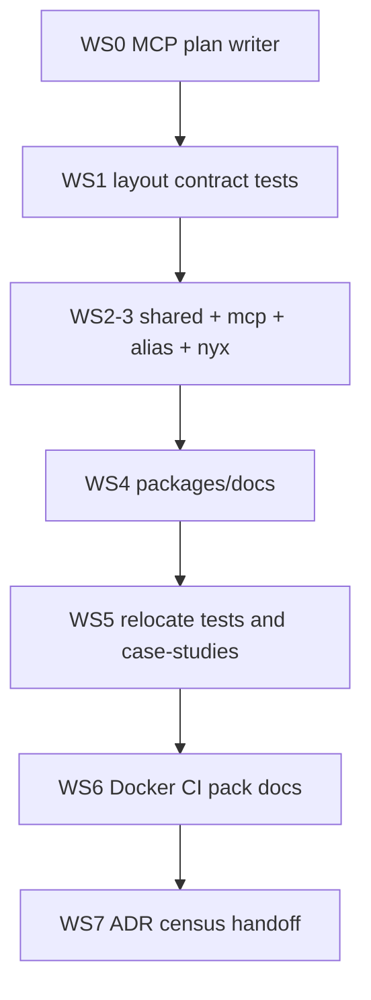

# Plan: pnpm workspace with `packages/{mcp,shared,docs}` + sibling Nyx

Status: `in-progress`
Notes: subordinate plan (leading `_`); coordinated by `docs/plans/plan-of-plans.md` workstream WS-D. Replaces `_2026-10-01-scripts-mcp-layout.md`. Executes on `rel/v0.1.0` (ADR 181). Do not create `refactor/packages-mcp-nyx-workspace`. WS0 landed (`rule_tool_write_plan`).

- **Date**: 2026-10-01
- **Updated**: 2026-11-01 (rename to `_scripts-mcp-layout.md`; WS0 plan-writer; branch = `rel/v0.1.0`)
- **Execution branch**: `rel/v0.1.0`
- **Repos**: workspace root (this git tree) + sibling `../nyx` (`nyx-gateway`)

## Goal

1. Durable plans live under `docs/plans/_*.md` via an MCP plan-writer (host CreatePlan is session UI only).
2. Real **pnpm workspace** under this repo.
3. `src/` → **`packages/mcp`** (server), minus extracted shared/utils.
4. Cross-cutting helpers → **`packages/shared`**.
5. Docs site builder → **`packages/docs`** (ex `scripts/docs-site`).
6. Nyx stays sibling `../nyx`, workspace-linked.
7. Relocate tests + case-study apps; retarget every consumer.

## Package names (fixed)

| Path              | `package.json` `name`                  | Role                                                             |
| ----------------- | -------------------------------------- | ---------------------------------------------------------------- |
| repo root         | `rule-mcp-workspace` (`private: true`) | Facade: `bin/`, top-level scripts, publish orchestration         |
| `packages/mcp`    | **`rule-mcp`**                         | MCP server (published product)                                   |
| `packages/shared` | **`rule-mcp-shared`**                  | Helpers for root, mcp, docs, scripts                             |
| `packages/docs`   | **`rule-mcp-docs`**                    | Static site builder over `docs/` markdown                        |
| `../nyx`          | `nyx-gateway`                          | Sibling decision engine (unchanged git)                          |

Root cannot keep the name `rule-mcp` if `packages/mcp` owns that name. Publish from `packages/mcp`.

## Fixed layout decisions

| Choice                                    | Value                                                                                           |
| ----------------------------------------- | ----------------------------------------------------------------------------------------------- |
| Workspace members                         | `packages/*` + `../nyx`                                                                         |
| Nyx import                                | `nyx-gateway/mcp`                                                                               |
| MCP deps                                  | `"rule-mcp-shared": "workspace:*"`, `"nyx-gateway": "workspace:*"`                              |
| Docs deps                                 | `marked` (+ workspace shared only if needed)                                                    |
| Alias                                     | `@mcp/*` → `packages/mcp/`; shared via `rule-mcp-shared` / `rule-mcp-shared/…`                  |
| `tests/`                                  | → `scripts/__tests__/`                                                                          |
| Case-study apps                           | → `docs/case-studies/`                                                                          |
| Launcher                                  | `scripts/case-studies/`                                                                         |
| Markdown `docs/**`                        | stays content tree                                                                              |
| `personas/` / `skills/` / root `prompts/` | stay at repo root                                                                               |
| CI without sibling Nyx                    | stub `nyx-gateway` + `RULE_MCP_NO_NYX=1`                                                        |

## `packages/shared` boundary

**IN:** entire `src/shared/` + entire `src/utils/` (as `packages/shared/utils/`). No re-export shim in mcp.

**OUT (stay in mcp):** `core/text`, `core/commit`, `core/git`, `core/file-tree`, `core/bm25`, `core/skills`, `core/guardrails`, `core/nyx`, runtime (`tokensave`, `telemetry`, `session`, `cache`), `cli/`, `tools/`, `server/`, `transport/`, `prompts/`, `resources/`, skill guardrail SDK (ADR 089).

**Non-goals:** do not vacuum every mcp import into shared; skills must not depend on `rule-mcp-shared`; `core/text` extract is a later ADR only.

Shared exports:

```json
{
  "name": "rule-mcp-shared",
  "type": "module",
  "exports": {
    ".": "./index.js",
    "./ports": "./ports/index.js",
    "./utils": "./utils/index.js",
    "./package.json": "./package.json"
  }
}
```

## Target tree

```text
rule-mcp/                    # git root; name: rule-mcp-workspace
├── bin/rule-mcp.js          # entry → packages/mcp
├── packages/
│   ├── shared/              # rule-mcp-shared  (ex src/shared + src/utils)
│   ├── mcp/                 # rule-mcp         (ex src/ minus shared+utils)
│   └── docs/                # rule-mcp-docs    (ex scripts/docs-site)
├── scripts/
│   ├── alias-hook.mjs
│   ├── __tests__/           # ex tests/
│   └── case-studies/        # launcher
├── docs/                    # markdown + case-study apps + plans
├── personas/ skills/ prompts/
├── package.json
└── pnpm-workspace.yaml

../nyx/                      # nyx-gateway
```

## Dependency graph

WS0 (plan home) is HARD before any monorepo move. Authoring of this file may land with or before WS0. WS2 and WS3 serialize in one green arc (shared extract then mcp move before `pnpm test`). One workstream owns each file set; CONFLICT on shared consumers runs serial.

```
WS0  MCP plan-writer + agent instructions
  |
  +--> WS1  layout contract tests (red)
         |
         +--> WS2  extract rule-mcp-shared
                |
                +--> WS3  packages/mcp + root rename + @mcp + nyx  (same green arc as WS2)
                       |
                       +--> WS4  packages/docs
                              |
                              +--> WS5  relocate tests + case-studies
                                     |
                                     +--> WS6  Docker / CI stub / pack / docs sweep
                                            |
                                            +--> WS7  ADR + census + handoff
```



Depends on: ADR 154 (plan shape), ADR 181 (one-branch orchestration), ADR 204 (STE100 writing)

Feeds: plan-of-plans WS-D scripts-layout row; published package layout for release

Shared files: `package.json`, `pnpm-workspace.yaml`, `docs/plans/plan-of-plans.md`, `docs/02-architecture.md`, `docs/05-env-variables.md`, `docs/handoff/HANDOFF.md`, `Dockerfile`, `.github/workflows/ci.yml`, `scripts/alias-hook.mjs`, `scripts/package.sh`, `scripts/ci/run-tests/`

## Workstreams

### WS0 — Plan home (MCP writer) — HARD first

Host CreatePlan writes only under `~/.local/share/opencode/plans/` (session UI). Source of truth here is `docs/plans/_*.md` registered in `plan-of-plans.md`. MCP cannot patch Cursor CreatePlan; ship a writer and instruct agents to use it.

- [x] **WS0-T1**: Inventory existing plan/persona writers (`rule_tool_impersonation` / review sync -> `docs/plans/<role>.md` per ADR 59). Added `rule_tool_write_plan` (persona `rule_tool_plan` unchanged).
- [x] **WS0-T2**: Write `docs/plans/_<slug>.md` only (reject missing `_`; reject silent overwrite without explicit flag); patch `plan-of-plans.md` section 1 + workstream (default WS-D).
- [x] **WS0-T3**: TDD with temp `projectDir`: file created with Status + Dependency graph; index updated; path without `_` rejected.
- [x] **WS0-T4**: Update `AGENTS.md` / `CLAUDE.md` (and rule-mcp instruction block): durable plans use the MCP plan-writer; CreatePlan host file is not the source of truth.
- [x] **WS0-T5**: Gate - writer tests green; no `git mv src` yet.

### WS1 — Layout contract tests (red)

- [x] **WS1-T1**: Assert root `package.json` name = `rule-mcp-workspace`, `private: true`.
- [x] **WS1-T2**: Assert `packages/{mcp,shared,docs}/package.json` fixed names; `pnpm-workspace.yaml` lists `packages/*` and `../nyx`.
- [x] **WS1-T3**: Assert zero root `src/`, `tests/`, `case-studies/`, `scripts/docs-site`; zero legacy `@`+`src` alias; `getRepoRoot()` resolves git root; mcp alias resolves.
- [x] **WS1-T4**: Set this plan Status `in-progress`; check WS-D box progress in `plan-of-plans.md`.
  - Note: contract file `scripts/__tests__/plans/monorepo-layout.test.mjs` is red until WS2-WS6.

### WS2 — Extract `rule-mcp-shared`

- [x] **WS2-T1**: `git mv src/shared packages/shared`; `git mv src/utils packages/shared/utils`.
- [x] **WS2-T2**: Add `packages/shared/package.json` with exports above; keep `_testkit` on main barrel.
- [x] **WS2-T3**: Do not run the full suite until WS3 lands (same green arc).

### WS3 — `packages/mcp` + imports

- [x] **WS3-T1**: `git mv src packages/mcp` (shared/utils already moved).
- [x] **WS3-T2**: `packages/mcp/package.json` name `rule-mcp`; deps include `rule-mcp-shared` + `nyx-gateway` workspace; move publish/`files` from root.
- [x] **WS3-T3**: Root → `rule-mcp-workspace` private; keep `bin.rule-mcp`; scripts delegate via `pnpm --filter`.
- [x] **WS3-T4**: Fix `getRepoRoot` / `getSkillsDirs` depth (`../../../` → `../../../../`); `RULE_MCP_REPO_ROOT` override unchanged.
- [x] **WS3-T5**: Alias hook → `packages/mcp/`; rewrite `@mcp/` → `@mcp/`; shared imports → `rule-mcp-shared`(+`/ports`/`/utils`); Nyx specifier → `nyx-gateway/mcp`.
- [x] **WS3-T6**: `pnpm-workspace.yaml` members; re-evaluate root `rule-mcp: 'link:'` override; suite green with real sibling Nyx.

### WS4 — `packages/docs`

- [x] **WS4-T1**: `git mv scripts/docs-site packages/docs`; package `rule-mcp-docs`; move `marked` if docs-only.
- [x] **WS4-T2**: Root `docs:dev` / `docs:build` → `pnpm --filter rule-mcp-docs …`; content stays `docs/**`.

### WS5 — Relocate tests + case-studies

- [x] **WS5-T1**: `git mv tests scripts/__tests__`; `git mv case-studies docs/case-studies` (launcher stays `scripts/case-studies/`).
- [x] **WS5-T2**: Retarget suite globs, eslint (`bin/ packages/ scripts/__tests__/`), package.json `test*`/`lint*`, census, docs-accuracy paths, fixtures.

### WS6 — Docker, CI, pack, docs

- [x] **WS6-T1**: Dockerfile `COPY packages/`; CMD via `bin/rule-mcp.js`; syntax-check under `bin` + `packages`.
- [x] **WS6-T2**: CI stub `../nyx` when missing; `RULE_MCP_NO_NYX=1`; eslint/find paths.
- [x] **WS6-T3**: `scripts/package.sh` → `pnpm pack --filter rule-mcp`.
- [x] **WS6-T4**: README / CONTRIBUTING / `docs/02-architecture.md` / `docs/05-env-variables.md` say workspace root + package `rule-mcp`.
- [x] **WS6-T5**: Closing sweep zero hits: `src/shared`, `src/utils`, `packages/mcp/shared`, `packages/mcp/utils`, `scripts/docs-site`, legacy `@src/`, bare `nyx/mcp`, root `"name": "rule-mcp"`.

### WS7 — Closeout

- [ ] **WS7-T1**: Product ADR pending (monorepo layout + publish boundary); do not amend ADR 134.
- [ ] **WS7-T2**: Plan + plan-of-plans WS-D boxes; `pnpm census:check`; quick then all suites; `rule_tool_check` on touched surfaces.
- [ ] **WS7-T3**: Numbered handoff; Conventional `type(scope):` commits per concern; **no push** unless asked.

## Closing sweep

Must find zero hits for:

- `src/shared`, `src/utils`, `packages/mcp/shared`, `packages/mcp/utils` (no shim)
- `scripts/docs-site`
- legacy `@src/`, bare `nyx/mcp`
- root `package.json` `"name": "rule-mcp"`

## Risks

- Root rename vs docs that still say the root package is `rule-mcp`
- Under-extraction of `core/text` left in mcp (accepted)
- Sibling Nyx missing in CI → stub + `RULE_MCP_NO_NYX=1`
- `getRepoRoot` depth after move

## Out of scope

- Vendoring nyx
- Extracting `core/text` into shared
- Skills depending on shared
- Extra packages beyond `mcp` / `shared` / `docs`
- Creating `refactor/packages-mcp-nyx-workspace`

## Model assignment

Classes and evidence: section 12 of `docs/plans/plan-of-plans.md`.

| Step | Class     | Model                | Why                                      |
| ---- | --------- | -------------------- | ---------------------------------------- |
| WS0  | `T3-rules`| `step-5-preview`     | new tool surface + TDD                   |
| WS1–WS7 | `T5-bulk` | `minimax-m3.1-flash` | layout move across many files, gate-checked |

Plan default: `T5-bulk`. Fallback: `step-5-preview` for authoring, `glm-5.3-flash` for bulk edits.
