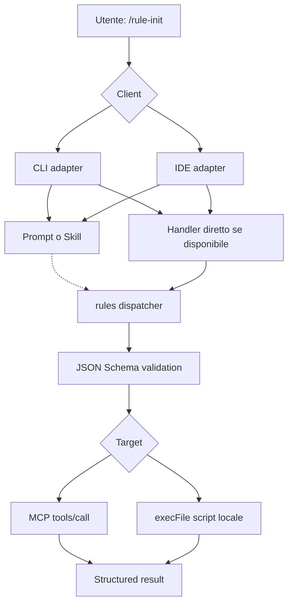

# Slash commands custom, MCP e script CLI: panoramica

> [!important] Obiettivo
> Implementare `/rule-init`, `/rule-check` e altri comandi per richiamare strumenti MCP oppure script CLI, distinguendo prompt/Skills e handler diretti.

> [!warning] Livello di verifica
> Ricerca documentale al 25 ottobre 2026. `confirmed` indica riscontro nella documentazione, **non** test locale end-to-end; `partial`, `migration`, `needs-test`, `ambiguous` e `plugin-dependent` esprimono limiti reali. Nessuna implementazione non documentata viene presentata come garantita.

## Classificazione

L'etichetta CLI riguarda le interfacce terminali; IDE include editor e loro estensioni; Hybrid copre più superfici. Devin è un ambiente cloud agentico, non un IDE desktop classico.

| Client | Categoria | Evidenza | Integrazione consigliata |
|---|---|---|---|
| [[CLI/codex-cli|OpenAI Codex CLI]] | CLI | confirmed (Skills) | Skill + dispatcher |
| [[CLI/copilot-cli|GitHub Copilot CLI]] | CLI | confirmed (experimental extension) | Native extension JS + dispatcher |
| [[CLI/claude-code|Claude Code]] | CLI | confirmed | Prompt/Skill + dispatcher |
| [[CLI/gemini-cli|Gemini CLI]] | CLI | confirmed | Prompt/Skill + dispatcher |
| [[CLI/opencode|OpenCode]] | CLI | confirmed | Prompt/Skill + dispatcher |
| [[CLI/pi-coding-agent|Pi Coding Agent]] | CLI | confirmed | Native extension |
| [[CLI/kimi-code-cli|Kimi Code CLI]] | CLI | partial | Prompt/Skill + dispatcher |
| [[CLI/factory-droid|Factory Droid]] | CLI | confirmed | Prompt/Skill + dispatcher |
| [[CLI/qwen-code|Qwen Code]] | CLI | confirmed | Prompt/Skill + dispatcher |
| [[CLI/kiro-cli|Kiro CLI]] | CLI | needs-test | Prompt/Skill + dispatcher |
| [[CLI/grok|Grok]] | CLI | ambiguous | Prompt/Skill + dispatcher |
| [[CLI/vibe|Vibe]] | CLI | ambiguous | Prompt/Skill + dispatcher |
| [[Hybrid/cline|Cline]] | Hybrid | confirmed | Prompt/Skill + dispatcher |
| [[IDE/roo-code|Roo Code]] | IDE | confirmed | Prompt/Skill + dispatcher |
| [[IDE/zed|Zed]] | IDE | confirmed | Prompt/Skill + dispatcher |
| [[Hybrid/google-antigravity|Google Antigravity]] | Hybrid | migration | Prompt/Skill + dispatcher |
| [[Hybrid/devin|Devin]] | Cloud IDE | needs-test | Prompt/Skill + dispatcher |
| [[Hybrid/kilo-code|Kilo Code]] | Hybrid | partial | Prompt/Skill + dispatcher |
| [[IDE/vs-code|VS Code]] | IDE | confirmed | Prompt/Skill + dispatcher |
| [[IDE/jetbrains-ai-assistant|JetBrains AI Assistant]] | IDE | confirmed | Prompt/Skill + dispatcher |
| [[IDE/neovim|Neovim]] | IDE | plugin-dependent | Prompt/Skill + dispatcher |
| [[IDE/emacs|Emacs]] | IDE | plugin-dependent | Prompt/Skill + dispatcher |

## Studio approfondito Codex + Copilot

- [[CLI/codex-copilot-deep-dive|Studio integrale su Codex CLI e GitHub Copilot CLI]], incluse le differenze fra Skills ed Extensions, tutti gli snippet JS/MCP, i diagrammi Mermaid e le fonti ufficiali.

## Architettura unificata

**Nota:** il tratteggio indica che un prompt/Skill può non eseguire il dispatcher perché media il modello. L'esistenza di uno slash non implica necessariamente esecuzione deterministica.

## Supporti aggiuntivi

- [[Extra/cursor|Cursor]]
- [[Extra/windsurf|Windsurf]]
- [[Extra/aider|Aider]]
- [[Extra/continue|Continue]]
- [[Extra/goose|Goose]]
- [[Extra/trae|Trae]]
- [[Extra/junie|Junie]]
- [[Extra/amp|Amp]]
- [[Extra/openhands|OpenHands]]
- [[Extra/cursor-cli|Cursor CLI]]

## File fondamentali

- [[Architecture/Decisioni]]: matrice decisionale e priorità.
- [[Architecture/Contratto-unificato]]: manifest e diagrammi.
- [[Snippets/Esempi-pronti]]: comandi e snippet da adattare.
- [[Architecture/Fonti]]: link alla documentazione primaria.

## Criterio guida

1. **Hard deterministic:** handler JS/TS/Lua/Elisp oppure CLI dispatcher che esegue tool o script direttamente.
2. **Prompt-mediated:** comando carica istruzioni e l'agente decide quando chiamare MCP o shell.
3. **Lifecycle deterministic:** hook automatico quando si verifica un evento specifico, non equivalente a `/rule-init`.
4. **MCP prompt:** prompt esposto da server, diverso da `tools/call`.
