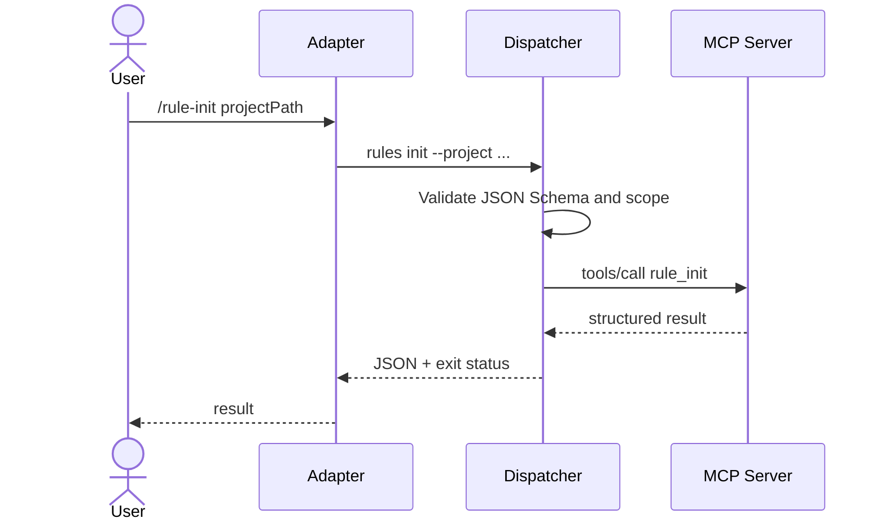

# Manifest, MCP e dispatcher

Questo manifest è **una proposta architetturale**, non un formato ufficiale di alcun client.

```json
{
  "name": "rule-init",
  "description": "Initialize project engineering governance",
  "version": "1.0.0",
  "target": {
    "type": "mcp",
    "server": "pix-galaxy-mcp",
    "tool": "rule_init"
  },
  "arguments": {
    "type": "object",
    "properties": {
      "projectPath": {"type": "string"}
    },
    "required": ["projectPath"],
    "additionalProperties": false
  }
}
```



Per rendere davvero deterministico il workflow, registrare versione schema, working directory canonica, timeout, audit ID, hash degli input e codici di errore stabili. L'idempotenza deve essere garantita dal tool, non dal solo slash command.
