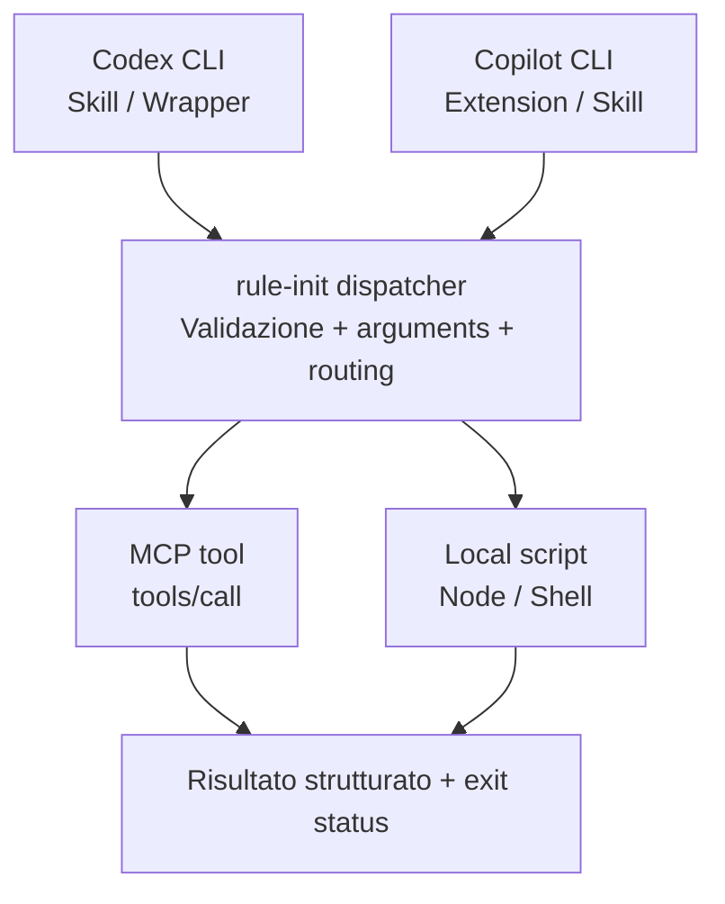
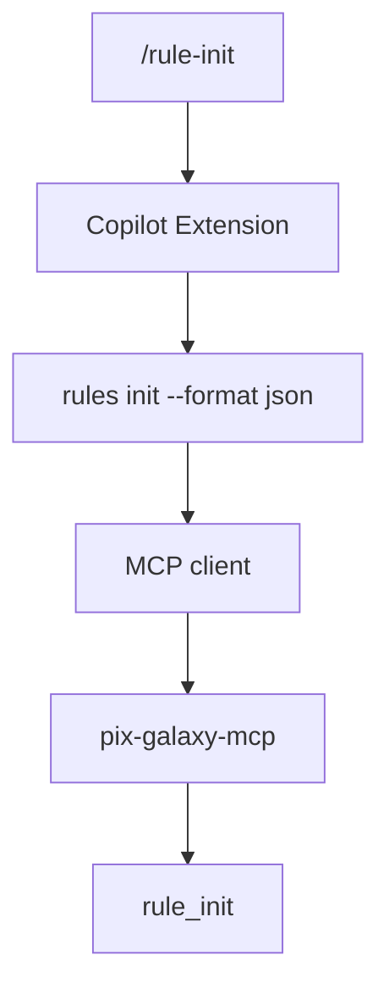

# Custom Slash Commands in Codex CLI e GitHub Copilot CLI

> [!info] Studio tecnico, 25 ottobre 2026
> Focus: MCP, script locali, comandi deterministici e portabilità.
>
> Questa nota raccoglie il testo, gli esempi e i diagrammi della risposta in chat, adattando il diagramma SVG in Mermaid, supportato nativamente da Obsidian. I riferimenti alle fonti sono collegamenti diretti, anziché identificatori di citazione della chat. Le API e i percorsi sperimentali vanno verificati contro la versione dei client effettivamente installata.

La ricerca ha evidenziato una differenza importante: **GitHub Copilot CLI permette di registrare veri slash command personalizzati eseguiti da codice JavaScript**, mentre **Codex CLI ha abbandonato il precedente sistema di custom prompt slash command in favore delle Agent Skills**.

Questo cambia parecchio l'architettura da scegliere se vogliamo ottenere un comportamento come:

```text
/rule-init
/rule-check
/rule-sync
/rule-validate
```

In particolare, dobbiamo distinguere due obiettivi:

1. **Invocazione dichiarativa**, un comando richiama istruzioni che guidano l'agente verso uno specifico tool MCP o script.
2. **Invocazione deterministica**, un comando esegue direttamente un handler che chiama un tool MCP o uno script, senza affidare al modello la decisione di quale operazione eseguire.

Per un sistema di engineering governance basato su MCP, la seconda possibilità è particolarmente interessante.

## 1. Matrice comparativa

| Capacità | Codex CLI | Copilot CLI |
|---|---|---|
| Slash command nativi | Sì | Sì |
| Custom slash tramite Markdown | Non più supportati come in passato | Sì, tramite plugin |
| Skills personalizzate | Sì | Sì |
| Richiamo di una skill da prompt | `$rule-init` | `/rule-init` come riferimento alla skill |
| Registrazione slash tramite codice JS | Non documentata come API pubblica equivalente | Sì, con Extensions |
| Collegamento a tool MCP | Sì | Sì |
| Esecuzione script locali | Sì, tramite strumenti dell'agente | Sì, anche direttamente da Extension |
| Esecuzione senza decisione del modello | Wrapper CLI esterno | Extension JS |
| Supporto a hook | Sì, dove previsti | Sì |

> [!note]
> Il riferimento a `/rule-init` in Copilot tramite skill non equivale alla registrazione di un comando eseguibile. La distinzione è fondamentale per un workflow deterministico. Le Extensions di Copilot sono ancora sperimentali.

Fonti principali: [Codex Skills](https://developers.openai.com/codex/skills), [Codex CLI slash commands](https://developers.openai.com/codex/cli/slash-commands), [Copilot CLI Extensions](https://docs.github.com/en/copilot/tutorials/create-an-extension), [Copilot plugin reference](https://docs.github.com/en/copilot/reference/copilot-cli-reference/cli-plugin-reference).

## 2. Architettura che sceglierei



*Architettura proposta, non una funzionalità nativa comune ai due prodotti.*

L'idea è avere **un solo contratto operativo per il comando** e due adapter specifici per i diversi client. La logica di governance vive in uno script o tool MCP indipendente dall'agente e rimane riutilizzabile.

## 3. Codex CLI, come implementarlo

### Stato attuale dei custom slash commands

Storicamente Codex supportava file Markdown in:

```text
~/.codex/prompts/rule-init.md
```

Questi venivano esposti come custom prompt, invocabili attraverso il menu slash, nelle versioni che implementavano il meccanismo.

Ma dalla versione 0.117.0, pubblicata a marzo 2026, il vecchio meccanismo risulta rimosso. Anche la documentazione ufficiale indirizza ora verso le Skills per le istruzioni riutilizzabili.

Quindi **non investirei su `~/.codex/prompts/`** per un'integrazione nuova.

Fonti: [Codex Skills](https://developers.openai.com/codex/skills), [Codex CLI slash commands](https://developers.openai.com/codex/cli/slash-commands).

### Soluzione A: Agent Skill che richiama MCP

La struttura consigliata è:

```text
my-project/
└── .agents/
    └── skills/
        └── rule-init/
            ├── SKILL.md
            └── scripts/
                └── init.mjs
```

Questo è un esempio di `SKILL.md`:

````markdown
---
name: rule-init
description: Initialize engineering governance rules for the current project.
---

# Rule Initialization

When this skill is explicitly invoked:

1. Determine the current project root.
2. Invoke the `rule_init` tool exposed by the
   `pix-galaxy-mcp` MCP server.
3. Pass the project root as `projectPath`.
4. Do not substitute other tools or operations.
5. Report the MCP result and any errors.
6. Do not create or modify additional files
   unless the tool explicitly requires it.
````

Da Codex:

```text
$rule-init
```

Oppure attraverso il selettore `/skills`.

La documentazione conferma anche che le skills possono dichiarare dipendenze da tool MCP tramite il file opzionale `agents/openai.yaml`, e che si può disattivare l'invocazione implicita con `allow_implicit_invocation: false`.

Questo secondo dettaglio è utile per comandi come `rule-init`, che dovrebbero essere eseguiti su richiesta, non attivati casualmente per somiglianza semantica.

**Limite:** la skill istruisce un LLM. Anche quando l'istruzione è precisa, non abbiamo la stessa garanzia operativa di una chiamata diretta al tool MCP.

### Soluzione B: Agent Skill che esegue uno script

Il medesimo `SKILL.md` può invece chiedere esplicitamente:

```text
Execute the bundled script:

node scripts/init.mjs

Run it exactly once, check the exit status
and return stdout/stderr to the user.
```

Lo script può essere deterministico, senza chiamare alcun LLM.

La differenza è che l'esecuzione dello script viene comunque avviata dall'agente, soggetta a strumenti e autorizzazioni disponibili.

### Soluzione C: Wrapper esterno

Se la richiesta è avere un comportamento assolutamente ripetibile, si può creare una CLI indipendente:

```bash
rules init
rules check
rules validate
```

Questa CLI effettua direttamente le chiamate MCP e può essere invocata da Codex, Copilot, da una pipeline CI o dal terminale.

Non sarebbe un vero `/rule-init` registrato nell'interfaccia interattiva di Codex, ma separerebbe completamente l'esecuzione del comando dalle decisioni del modello.

Documentazione ufficiale: [Codex Skills](https://developers.openai.com/codex/skills) e [Codex CLI commands](https://developers.openai.com/codex/cli/slash-commands).

## 4. GitHub Copilot CLI, la soluzione più diretta

Qui la situazione è decisamente più interessante.

GitHub documenta un'API che permette di registrare comandi reali attraverso **Copilot CLI Extensions**, scritte in JavaScript e avviate come processi Node.js separati.

Le estensioni possono risiedere a livello di progetto oppure globale:

```text
# Project
.github/extensions/rules/extension.mjs

# Global
~/.copilot/extensions/rules/extension.mjs
```

Per abilitarle:

```bash
copilot --experimental
```

La funzionalità rimane sperimentale, ma ha già un tutorial ufficiale e un'API utilizzabile.

Fonte: [Create a Copilot CLI extension](https://docs.github.com/en/copilot/tutorials/create-an-extension).

### Esempio funzionante a livello di API: `/rule-init` -> script Node

```javascript
import { joinSession } from "@github/copilot-sdk/extension";
import { execFile } from "node:child_process";
import { promisify } from "node:util";
import { fileURLToPath } from "node:url";

const execFileAsync = promisify(execFile);

const script = fileURLToPath(
  new URL("./scripts/rule-init.mjs", import.meta.url)
);

const session = await joinSession({
  commands: [
    {
      name: "rule-init",
      description: "Initialize project engineering rules",
      handler: async (ctx) => {
        const projectPath = (ctx.args ?? "").trim();

        try {
          const { stdout, stderr } = await execFileAsync(
            process.execPath,
            [
              script,
              ...(projectPath ? [projectPath] : [])
            ],
            {
              cwd: process.cwd(),
              timeout: 30000
            }
          );

          if (stdout) {
            await session.log(stdout, { level: "info" });
          }

          if (stderr) {
            await session.log(stderr, { level: "warning" });
          }
        } catch (error) {
          await session.log(
            `rule-init failed: ${error.message}`,
            { level: "error" }
          );
        }
      }
    }
  ]
});
```

Ora nel terminale interattivo di Copilot:

```text
/rule-init
```

Oppure, passando esplicitamente il progetto:

```text
/rule-init /path/to/my-project
```

Il risultato è interessante perché:

- Il comando viene registrato direttamente nella CLI.
- L'handler è codice JavaScript, non un prompt.
- Lo script viene avviato direttamente dal processo dell'estensione.
- Non serve una decisione del modello per selezionare lo script.
- Exit code e output possono essere gestiti dall'handler.

L'esempio usa `process.cwd()` come directory predefinita, ma questo è solo un placeholder operativo. Per un'integrazione robusta occorre recuperare e validare la directory del workspace attivo, che potrebbe non coincidere con quella dell'estensione.

La registrazione con `joinSession({ commands: [...] })`, il contesto `ctx.args` e `session.log()` sono documentati da GitHub.

Fonte: [Copilot CLI Extensions](https://docs.github.com/en/copilot/tutorials/create-an-extension).

### E per chiamare direttamente un tool MCP?

Ci sono due possibilità.

#### Approccio 1, Extension -> MCP client -> MCP server

La stessa estensione può importare un client MCP e chiamare esplicitamente il tool desiderato.

Per esempio, usando il client ufficiale MCP SDK per un server locale `stdio`:

```javascript
import { Client } from "@modelcontextprotocol/sdk/client/index.js";
import { StdioClientTransport } from "@modelcontextprotocol/sdk/client/stdio.js";

const client = new Client({
  name: "rule-command-client",
  version: "1.0.0"
});

const transport = new StdioClientTransport({
  command: "node",
  args: ["/absolute/path/to/mcp-server.mjs"]
});

try {
  await client.connect(transport);

  const result = await client.callTool({
    name: "rule_init",
    arguments: {
      projectPath: process.cwd()
    }
  });

  console.log(result);
} finally {
  await client.close();
}
```

Il codice rappresenta la logica da integrare nell'handler dell'estensione. I nomi `rule_init` e `projectPath` sono esemplificativi e vanno adattati allo schema effettivo del server.

Attenzione: questo esempio **avvia una nuova istanza `stdio` del server MCP**. Se dobbiamo condividere una singola istanza o lo stesso stato del server usato dall'agente, serve una connessione a un endpoint condiviso oppure un'altra forma di IPC.

#### Approccio 2, Extension -> Dispatcher CLI -> MCP

Personalmente preferisco questa architettura per la governance:



In questo modo la logica MCP è riutilizzabile anche al di fuori di Copilot e non viene duplicata in ogni estensione.

### Un'ulteriore opzione: distribuire comandi come plugin

GitHub supporta inoltre i plugin che includono slash commands, Skills, MCP configuration e altri componenti. Il formato Agent Plugins 1.0 prevede una directory `com.github.copilot/commands/` per i comandi specifici di Copilot.

Questo è interessante per distribuire un pacchetto unico con tutte le capacità `rule-*`. Per un comando che deve eseguire codice con controllo deterministico, però, rimane più chiaramente documentato il percorso delle Extensions JavaScript.

Documentazione ufficiale: [Create a Copilot CLI extension](https://docs.github.com/en/copilot/tutorials/create-an-extension), [Copilot CLI plugin reference](https://docs.github.com/en/copilot/reference/copilot-cli-reference/cli-plugin-reference).

## 5. Le Skills come livello portabile

La buona notizia è che entrambi i client supportano lo standard delle Agent Skills, con un file `SKILL.md` e risorse opzionali.

Per un progetto condiviso, questa può essere la struttura:

```text
my-project/
├── .agents/
│   └── skills/
│       └── rule-init/
│           ├── SKILL.md
│           └── scripts/
│               └── init.mjs
├── .github/
│   └── extensions/
│       └── rules/
│           └── extension.mjs
└── package.json
```

Per Codex, la skill si invoca con `$rule-init`. In Copilot, il nome della skill può essere richiamato esplicitamente nel prompt, mentre l'Extension registra separatamente il vero `/rule-init`.

Un'unica definizione semantica del workflow può quindi essere condivisa, anche se i due client espongono interfacce differenti.

Fonti: [Codex Skills](https://developers.openai.com/codex/skills), [Copilot Agent Skills](https://docs.github.com/en/copilot/how-tos/copilot-cli/customize-copilot/add-skills).

## 6. Cosa cambia sul determinismo?

La parte importante, soprattutto per un sistema di guardrail ingegneristici, è capire cosa possiamo effettivamente garantire.

| Proprietà | Skill | Copilot Extension | CLI diretta |
|---|---|---|---|
| Nome operazione prestabilito | Sì, nelle istruzioni | Sì, nel codice | Sì |
| Scelta tool senza LLM | No | Sì | Sì |
| Validazione argomenti tramite codice | Tramite script/tool | Sì | Sì |
| Risultato JSON strutturato | Possibile | Sì | Sì |
| Exit code verificabile | Tramite esecuzione script | Sì | Sì |
| Usabile in CI senza agente | Non direttamente | Non come slash | Sì |

Inoltre, distinguerei **determinismo dell'invocazione** e **determinismo dell'operazione**. Un handler può chiamare sempre lo stesso tool, ma se quel tool dipende da file modificabili, rete, orario corrente o stato Git, il risultato potrebbe comunque cambiare.

Per una governance rigorosa aggiungerei quindi validazione con JSON Schema, versionamento degli input, idempotenza dove possibile, logging delle chiamate e un risultato strutturato con codici di errore stabili.

## 7. La struttura che proporrei per `pix-galaxy-mcp`

> [!example] Pacchetto di integrazione proposto
> Un solo motore operativo, diversi adapter.

```text
pix-galaxy-integrations/
├── commands/
│   ├── rule-init.json
│   ├── rule-check.json
│   └── rule-sync.json
├── runtime/
│   ├── dispatcher.mjs
│   ├── mcp-client.mjs
│   └── validator.mjs
├── adapters/
│   ├── codex/
│   │   └── skills/
│   └── copilot/
│       └── extension.mjs
└── bin/
    └── rules.mjs
```

Ogni comando potrebbe essere dichiarato con un manifest indipendente dal client:

```json
{
  "name": "rule-init",
  "description": "Initialize project engineering rules",
  "version": "1.0.0",
  "target": {
    "type": "mcp",
    "server": "pix-galaxy-mcp",
    "tool": "rule_init"
  },
  "arguments": {
    "type": "object",
    "properties": {
      "projectPath": {
        "type": "string"
      }
    },
    "required": ["projectPath"],
    "additionalProperties": false
  }
}
```

Questo non è un formato nativo di Codex o Copilot, ma un contratto che possiamo definire noi.

Un generatore potrebbe leggere i manifest e produrre automaticamente:

- Le Skills condivise di Codex.
- Le definizioni per le Extensions di Copilot.
- La CLI `rules`, utilizzabile direttamente o in CI.
- La documentazione e i test per verificare che ogni comando punti al tool MCP previsto.

## 8. Documentazione di riferimento

| Documentazione | Perché è importante |
|---|---|
| [OpenAI Codex Skills](https://developers.openai.com/codex/skills) | Definizione, discovery e invocazione delle Skills |
| [Codex developer commands](https://developers.openai.com/codex/cli/slash-commands) | Interfaccia dei comandi nativi |
| [Copilot CLI Extensions tutorial](https://docs.github.com/en/copilot/tutorials/create-an-extension) | Registrazione effettiva di slash command JS |
| [Copilot Plugin Reference](https://docs.github.com/en/copilot/reference/copilot-cli-reference/cli-plugin-reference) | Packaging dei comandi personalizzati |
| [Copilot Agent Skills](https://docs.github.com/en/copilot/how-tos/copilot-cli/customize-copilot/add-skills) | Skills e script associati |
| [Copilot CLI Reference](https://docs.github.com/en/copilot/reference/copilot-cli-reference/cli-command-reference) | Gestione MCP, permessi e funzionalità sperimentali |

## Conclusione

La soluzione tecnicamente più solida non è cercare di replicare alla lettera il funzionamento degli slash command di Claude Code, perché Codex e Copilot hanno scelto modelli di estensibilità diversi.

Per un sistema come `pix-galaxy-mcp` sceglierei **un dispatcher JavaScript deterministico che gestisce MCP e script CLI, con Skills per Codex ed Extensions per Copilot**.

Il punto da verificare con un proof of concept locale è la parte effettivamente più delicata: il ciclo di vita del server MCP, i permessi dell'estensione, il passaggio corretto del workspace attivo e l'eventuale condivisione di stato tra le sessioni. La ricerca documentale conferma le API descritte, ma non costituisce ancora un test end-to-end sulle versioni installate dei due client.

Con questa separazione si possono aggiungere in seguito anche Claude Code, OpenCode e altri coding agent, senza spostare la logica di governance all'interno dei loro prompt.
