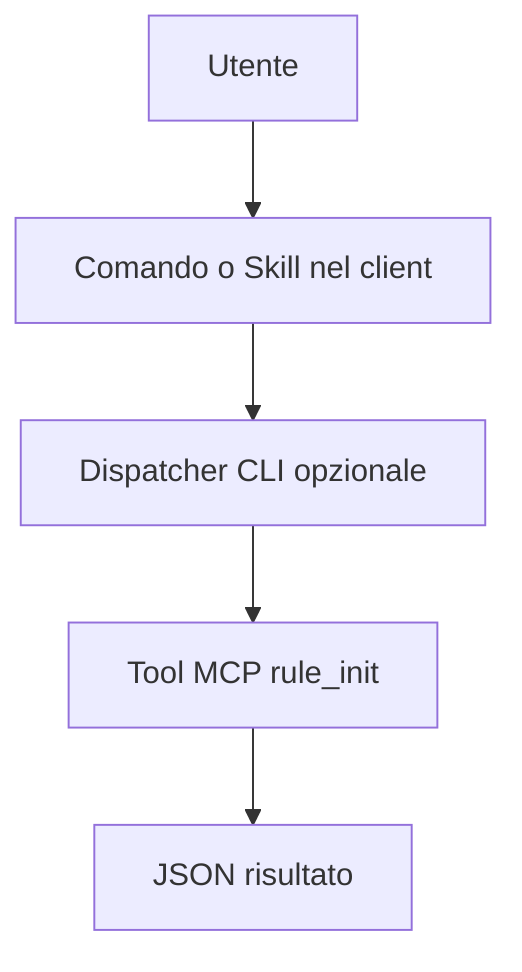

# OpenCode

> [!info] Classificazione
> **Superficie:** CLI. **Stato documentale:** `confirmed`.

## Integrazione di `/rule-init`

`.opencode/commands/rule-init.md` or `opencode.jsonc` command; shell interpolation `!` runs local command and includes its output.

## MCP e determinismo

Pre-prompt shell interpolation can be used for a direct script, but review output handling.

Proposta portabile: `/rule-init` (se disponibile) richiama il dispatcher `rules init --format json` che valida parametri, connessione MCP ed esito. Dove esiste solo un prompt o una Skill, la scelta dell'esecuzione dipende dal modello: non presentarla come chiamata diretta garantita.

## Verifica operativa

- [ ] Installare versione esatta e annotare `--version`.
- [ ] Confermare discovery di `/rule-init`.
- [ ] Verificare passaggio argomenti e path workspace.
- [ ] Testare success, error, timeout e autorizzazioni.
- [ ] Controllare se il tool viene realmente invocato senza intervento del modello.

## Documentazione

- [OpenCode, fonte principale](https://opencode.ai/docs/it/commands/)
