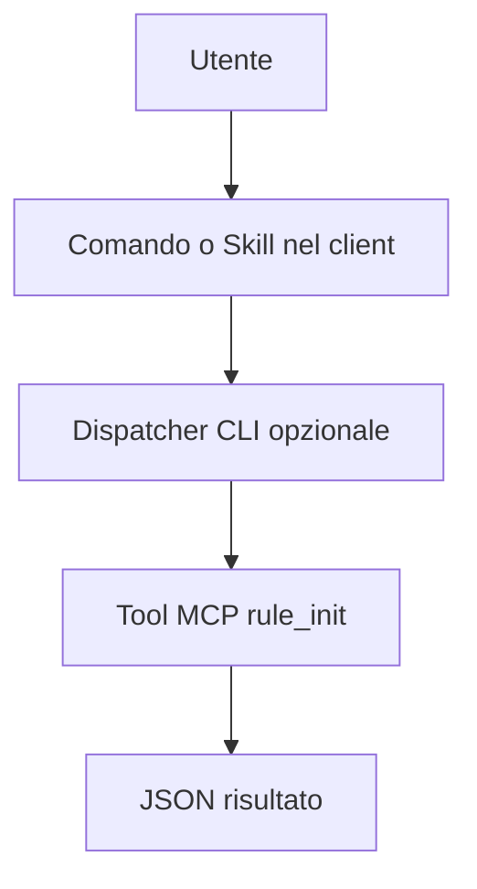

# Google Antigravity

> [!info] Classificazione
> **Superficie:** Hybrid. **Stato documentale:** `migration`.

## Integrazione di `/rule-init`

App and CLI expose slash commands. Legacy workflow system stopped working October 19, 2026; migrate to Skills.

## MCP e determinismo

Migration especially important as of October 25, 2026.

Proposta portabile: `/rule-init` (se disponibile) richiama il dispatcher `rules init --format json` che valida parametri, connessione MCP ed esito. Dove esiste solo un prompt o una Skill, la scelta dell'esecuzione dipende dal modello: non presentarla come chiamata diretta garantita.

## Verifica operativa

- [ ] Installare versione esatta e annotare `--version`.
- [ ] Confermare discovery di `/rule-init`.
- [ ] Verificare passaggio argomenti e path workspace.
- [ ] Testare success, error, timeout e autorizzazioni.
- [ ] Controllare se il tool viene realmente invocato senza intervento del modello.

## Documentazione

- [Google Antigravity, fonte principale](https://www.antigravity.google/docs/ide/workflows/)
