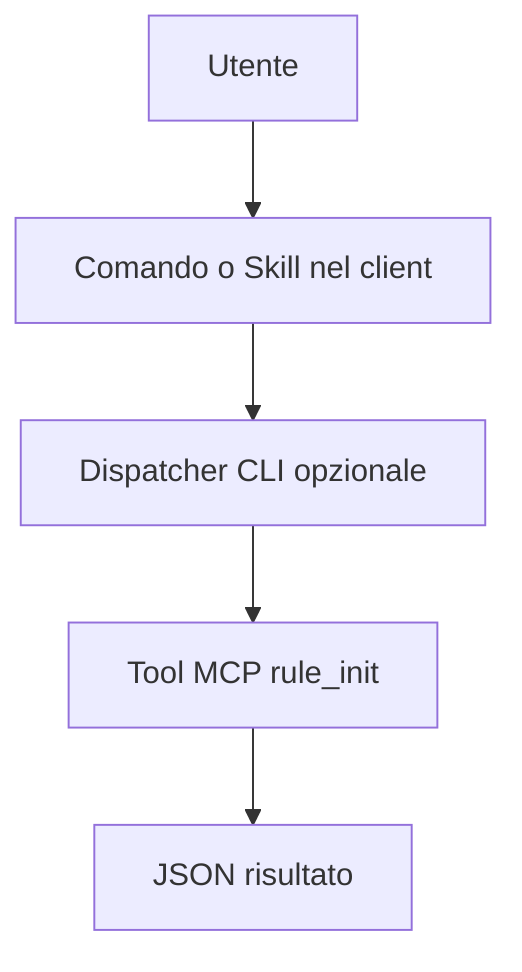

# Neovim

> [!info] Classificazione
> **Superficie:** IDE. **Stato documentale:** `plugin-dependent`.

## Integrazione di `/rule-init`

Depends on chosen plugin (e.g. CodeCompanion, avante, ACP adapters). No universal Neovim AI slash API.

## MCP e determinismo

Implement via Lua user commands and dispatcher where direct invocation needed.

Proposta portabile: `/rule-init` (se disponibile) richiama il dispatcher `rules init --format json` che valida parametri, connessione MCP ed esito. Dove esiste solo un prompt o una Skill, la scelta dell'esecuzione dipende dal modello: non presentarla come chiamata diretta garantita.

## Verifica operativa

- [ ] Installare versione esatta e annotare `--version`.
- [ ] Confermare discovery di `/rule-init`.
- [ ] Verificare passaggio argomenti e path workspace.
- [ ] Testare success, error, timeout e autorizzazioni.
- [ ] Controllare se il tool viene realmente invocato senza intervento del modello.

## Documentazione

- [Neovim, fonte principale](https://github.com/olimorris/codecompanion.nvim)
