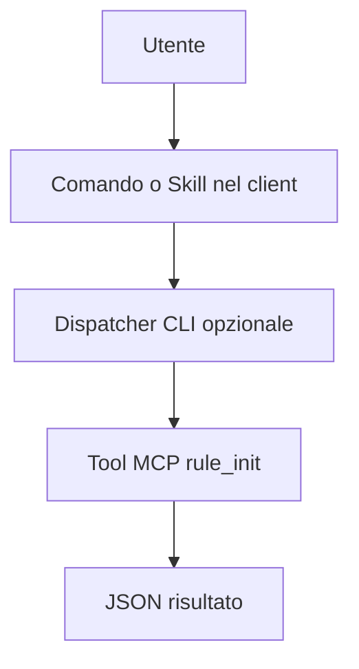

# Roo Code

> [!info] Classificazione
> **Superficie:** IDE. **Stato documentale:** `confirmed`.

## Integrazione di `/rule-init`

`.roo/commands/rule-init.md` or `~/.roo/commands/`; slash invokes reusable prompt, with MCP tools available.

## MCP e determinismo

Use script/tool to enforce deterministic action.

Proposta portabile: `/rule-init` (se disponibile) richiama il dispatcher `rules init --format json` che valida parametri, connessione MCP ed esito. Dove esiste solo un prompt o una Skill, la scelta dell'esecuzione dipende dal modello: non presentarla come chiamata diretta garantita.

## Verifica operativa

- [ ] Installare versione esatta e annotare `--version`.
- [ ] Confermare discovery di `/rule-init`.
- [ ] Verificare passaggio argomenti e path workspace.
- [ ] Testare success, error, timeout e autorizzazioni.
- [ ] Controllare se il tool viene realmente invocato senza intervento del modello.

## Documentazione

- [Roo Code, fonte principale](https://roocodeinc.github.io/Roo-Code/features/slash-commands/)
